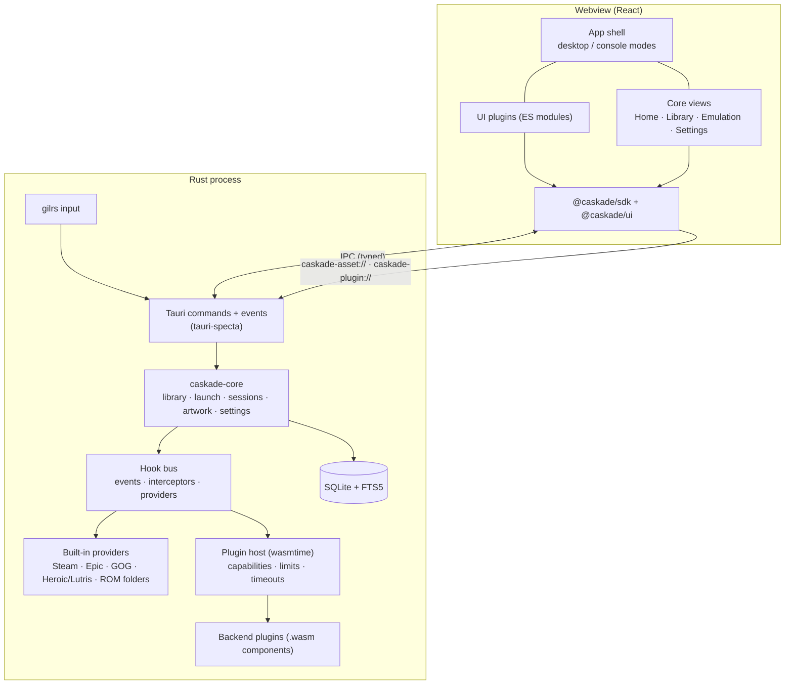

# Caskade — Technical Plan (Prototype)

Status: architecture reference; prototype milestones retained as historical context · Last updated: 2026-10-28

This document records the tech stack decisions for Caskade and lays out the architecture and milestones for the first working prototype. It is deliberately high level: it fixes the _shape_ of the system and the libraries we build on, and leaves detailed API design to per-area docs written as each milestone starts.

Fixed inputs: **Rust**, **Tauri 2**, **React + TypeScript**. Two first-class requirements drive most of the decisions below:

1. **Theming** — the UI must be fully re-skinnable by the community, in both desktop and console (gamepad) modes.
2. **A rich plugin system** — the community can add their own views and functionality through a rich hooks API.

---

## 1. Stack at a glance

### Backend (Rust)

| Concern                   | Decision                                                                                                     | Why                                                                                                                                                                                                              |
| ------------------------- | ------------------------------------------------------------------------------------------------------------ | ---------------------------------------------------------------------------------------------------------------------------------------------------------------------------------------------------------------- |
| App shell                 | **Tauri 2** (2.12.x line)                                                                                    | Given. Small binaries, native webview, capability-based IPC ACLs.                                                                                                                                                |
| Async runtime             | **tokio**                                                                                                    | Tauri's runtime; everything else (sqlx, reqwest, wasmtime async) plugs into it.                                                                                                                                  |
| Database                  | **SQLite via `sqlx`** (bundled SQLite, migrations in-repo)                                                   | Single-file, zero-admin, transactional. `sqlx` gives async queries and in-repo migrations.                                                                                                                       |
| Search                    | **SQLite FTS5** (trigram tokenizer)                                                                          | Instant "search any game" over title/aliases/tags with no extra service.                                                                                                                                         |
| Backend plugin runtime    | **wasmtime + WebAssembly Component Model (WASI 0.2)**                                                        | Sandboxed, capability-scoped, language-neutral plugins with a typed contract (WIT). wasmtime is pinned (`=50.0.1`) with its WASI `p2` host; guests build for `wasm32-wasip2`. See §4.                            |
| Rust ⇄ TS types           | **`specta` + `tauri-specta`** (pinned RC)                                                                    | Generates typed TS bindings for every command and event. Fallback if it stalls: `ts-rs` for types plus hand-written invoke wrappers.                                                                             |
| HTTP                      | **`reqwest`** (rustls)                                                                                       | Metadata/artwork fetching; also backs the plugin `wasi:http` implementation.                                                                                                                                     |
| Process launch & tracking | `tokio::process` + **`sysinfo`**                                                                             | Spawn games, then track the real game process (launchers like Steam fork it) for playtime.                                                                                                                       |
| Filesystem watching       | **`notify`**                                                                                                 | "Watch library folders for changes" (settings mockup).                                                                                                                                                           |
| Gamepad input             | **`gilrs`** (in Rust, not the web Gamepad API)                                                               | Webview gamepad support differs across WebView2, WKWebView and WebKitGTK, and it stops working when the window is unfocused. Reading pads natively lets the guide button summon Caskade while a game is running. |
| Images                    | **`image`** crate, served via a custom URI scheme                                                            | Download artwork once, generate thumbnails, and serve them from `caskade-asset://` so the library grid never decodes 4K covers.                                                                                  |
| Store/OS parsers          | `keyvalues-parser` (Steam VDF/ACF), `winreg` (Windows), `plist` (macOS); `.desktop` files use a small in-crate parser | Native discovery sources shown in the settings mockup.                                                                                                                                                           |
| Paths                     | **`directories`**                                                                                            | Per-OS data/config/cache dirs.                                                                                                                                                                                   |
| Errors / logging          | `thiserror` in library crates, **`tracing`** to stderr, filtered with `RUST_LOG`                   | Structured logs that we can tag per plugin.                                                                                                                                                                      |
| Settings schemas          | **`schemars`** (JSON Schema)                                                                                 | One schema format for core _and_ plugin settings, rendered automatically by the UI.                                                                                                                              |

Tauri plugins: `single-instance`, `window-state`, `deep-link` (`caskade://install` links), `dialog`. Updater comes after the prototype. We deliberately **do not** expose `tauri-plugin-fs` or `tauri-plugin-shell` to the webview. See §7.

### Frontend (React + TypeScript)

| Concern              | Decision                                                                                                 | Why                                                                                                                                                                                                                |
| -------------------- | -------------------------------------------------------------------------------------------------------- | ------------------------------------------------------------------------------------------------------------------------------------------------------------------------------------------------------------------ |
| Build                | **Vite**, TypeScript `strict`                                                                            | Standard Tauri pairing.                                                                                                                                                                                  |
| Package manager      | **pnpm workspaces**                                                                                      | Monorepo with the app plus publishable SDK/UI packages.                                                                                                                                                            |
| UI framework         | **React 19**                                                                                             | Given.                                                                                                                                                                                                             |
| Component primitives | **React Aria Components**                                                                                | Keyboard and focus management, which console mode builds on. It exposes state as `data-*` attributes (`data-hovered`, `data-focus-visible`, `data-selected`), which make clean theming hooks. |
| Spatial navigation   | In-app focus engine (`apps/desktop/src/input/spatial.ts`)                                               | D-pad moves focus to the nearest focusable element that way, grouped by `data-focus-section`; driven by `gilrs` actions.                                                                                                                                  |
| Styling              | **Tailwind CSS v4** (core only) over **CSS custom-property design tokens** + **cascade layers**          | Tailwind v4's `@theme` resolves utilities to CSS variables, so swapping token values restyles everything. The _public_ theming contract is tokens and `data-*` parts, never Tailwind class names. See §5.          |
| Routing              | **TanStack Router**                                                                                      | Type-safe routes and search params (library filters/sort live in the URL). Plugin views mount under one dynamic route.                                                                                             |
| Backend state        | **TanStack Query** over typed Tauri commands; core events invalidate queries                             | Caching, dedupe, background refresh.                                                                                                                                                                               |
| Big lists            | **TanStack Virtual**                                                                                     | Libraries of 1,000s of games with artwork.                                                                                                                                                                         |
| Icons                | **lucide-react**                                                                                         | Matches the line-icon style in the mockups.                                                                                                                                                                        |
| Lint/format          | **Biome** (TS), **rustfmt** + **clippy** (Rust)                                                          | One tool per language.                                                                                                                                                                                        |
| Tests                | **Vitest** + Testing Library (TS); `cargo test` / **cargo-nextest** + **insta** snapshots (Rust parsers) | End to end: the console-mode run drives the built app under Xvfb (`src-tauri/tests/console_e2e.rs`).                                                                                                                                                        |
| Component workshop   | **Storybook** (`apps/storybook`) for `@caskade/ui`                                                                          | Doubles as a live theme playground for theme authors.                                                                                                                                                              |

### Tooling & delivery

- **GitHub Actions** (`.github/workflows/`) on GitHub-hosted runners. The app workflow (`app.yml`) lints and tests on Linux, with Windows GNU cross-Clippy, and bundles (deb, AppImage) nightly; the installer and discovery crates also test on Windows and macOS; `release.yml` builds every platform from a tag. Pull requests run only what their changes reach (`docs/build-performance.md`).
- `just` as the task runner (`just dev`, `just test-app`, `just bindings`, `just plugin-new`).
- Code signing, auto-update, Flatpak, and the plugin registry are **post-prototype**.

---

## 2. Architecture



Principles:

- **`caskade-core` has no Tauri dependency.** It is a plain Rust library (domain model, DB, launch pipeline, hook bus), so it is unit-testable and can later back a CLI or headless service. `apps/desktop/src-tauri` is a thin adapter: commands, events, windows, URI schemes.
- **One internal provider trait per extension point.** Built-in Steam/Epic/etc. sources implement the same `LibrarySource` trait that WASM plugins are adapted to, so built-ins and community plugins use the same code paths. Built-ins stay native Rust for speed and OS access (registry, plist).
- **The webview never touches the OS directly.** All filesystem, process, and network access goes through core, which enforces permissions.

### Repository layout

```
caskade/
├── Cargo.toml                 # Rust workspace
├── package.json               # pnpm workspace root
├── justfile
├── wit/                       # WIT: the backend plugin contract (caskade:plugin@0.1.0)
├── crates/
│   ├── caskade-core/          # domain, DB, launch pipeline, hook bus
│   ├── caskade-sources/       # built-in library sources (adapters over caskade-discovery), metadata providers, emulation data (see EMULATION-PLAN.md)
│   ├── caskade-installer/     # install from file/folder/URL, uninstall, move installs (see its README.md)
│   ├── caskade-discovery/     # find already-installed games from launchers and the OS (see its docs/)
│   ├── caskade-plugin-host/   # wasmtime host, capability enforcement, plugin lifecycle
│   └── caskade-plugin-sdk/    # Rust SDK for plugin authors (wit-bindgen + macros)
├── apps/desktop/
│   ├── src-tauri/             # Tauri app: commands, events, URI schemes, windows
│   └── src/                   # React app: shell, core views, plugin loader
├── packages/
│   ├── sdk/                   # @caskade/sdk – plugin API, React hooks, generated types
│   ├── ui/                    # @caskade/ui – themeable component library
│   ├── tokens/                # design-token schema + build (DTCG JSON → CSS vars)
│   ├── vite-plugin/           # @caskade/vite-plugin – build preset for UI plugins/themes
│   └── create-plugin/         # plugin scaffolder (`just plugin-new`)
├── themes/default/            # the default theme, shipped as a regular theme package
├── plugins/examples/          # dogfooded example plugins
└── docs/
```

---

## 3. Domain model (core)

| Entity                                    | Notes                                                                                                                                                                     |
| ----------------------------------------- | ------------------------------------------------------------------------------------------------------------------------------------------------------------------------- |
| **Game**                                  | Canonical record the user sees: title, sort title, description, genres, tags, release date, platform(s), artwork refs, user fields (favourite, hidden, rating, notes).    |
| **GameEntry**                             | One per _source_: `source_id` + `external_id`, install state, install location, size, and a `LaunchSpec`. Several entries can point to one Game ("Merge duplicate entries"). The install location is `Managed { root_id, rel_dir }` for games Caskade installed, or `External(path)` for games another launcher owns (Steam, Heroic, …). Managed locations are **never stored as absolute paths**, so games and whole roots can move. |
| **StorageRoot**                           | A Caskade-managed install folder (Settings → Storage): id (also written to `<root>/.caskade/root.json`), current path, default flag. A root that reappears at a new path (drive letter or mount point changed) is matched by its id. |
| **LaunchSpec**                            | Tagged union: `Uri` (`steam://rungameid/…`), `Executable` (path, args, cwd, env; for managed installs, paths are relative to the install location and resolved through the game's stable alias at launch), `Emulator` (launch target — platform default, pinned profile, or ask — plus ROM list and per-game args), `Plugin` (delegated to a plugin runner). |
| **Platform / Emulator / EmulatorProfile** | Platforms and emulator definitions are data (TOML), with per-OS detection rules, argument templates and BIOS lists. Emulators, profiles, platform defaults and ROM scanners are user config. Plugins can contribute definitions. See `EMULATION-PLAN.md`. |
| **PlaySession**                           | Start, end, duration, and which entry was launched. Drives "Recently Played", playtime, and "Continue Playing".                                                           |
| **Collection**                            | Manual or smart (saved filter query).                                                                                                                                     |
| **Artwork**                               | Kind (cover, hero, logo, icon, screenshot), source, cached path, thumbnail sizes.                                                                                         |
| **PluginState**                           | Installed plugins, granted permissions, enabled flag, per-plugin KV storage.                                                                                              |

The **launch pipeline** is the main use of hooks: resolve `LaunchSpec` → run `launch.before` interceptors (may rewrite command/env or cancel) → spawn → identify the real game process (by install dir/exe via `sysinfo` polling, matching both the real path and the game's alias path) → `game.started` → wait for exit → persist `PlaySession` → `game.exited` → `launch.after` interceptors (e.g. save sync).

---

## 4. Plugin system

### 4.1 Model: one package, two optional halves

A plugin is a folder (later a signed `.zip`) with a manifest and up to two entry points:

| Half                         | Runs in                       | Language                                                       | Used for                                                                                  |
| ---------------------------- | ----------------------------- | -------------------------------------------------------------- | ----------------------------------------------------------------------------------------- |
| **UI** (`ui.js`)             | Main webview, same React tree | TypeScript/React (any language that compiles to an ES module)  | Views, panels, badges, menus, commands, settings pages.                                   |
| **Backend** (`backend.wasm`) | wasmtime in the Rust process  | Rust (the only supported language in 0.1; see §4.5)            | Library sources, metadata providers, launch runners, hooks/interceptors, background work. |

A plugin can have either half or both. When it has both, the UI half talks to its own backend half with `ctx.backend.call("method", args)`, which core routes to the component's `handle-request` export.

**Why this split (and not the alternatives):**

- _UI in the same webview, not iframes:_ plugins must render "their own views" that look native. They need the real React instance, `@caskade/ui` components, theme tokens, and the spatial-navigation focus tree. An iframe per plugin breaks theming, focus, and console mode.
- _Backend in WASM, not in the webview:_ hooks like `launch.before` and `game.exited` must work while the window is hidden or in the tray. Library scans and HTTP shouldn't block the UI. Running untrusted code that touches the filesystem and the network needs a real sandbox. Wasmtime gives us that: capability-based WASI (preopened dirs only), an `wasi:http` host allowlist, memory limits (`ResourceLimiter`), and CPU time limits (epoch interruption).
- _Rejected:_ **embedded JS engine** (`deno_core`/V8: big binary, slow builds, sandboxing is DIY); **out-of-process Node/Bun host** (ships a 50–100 MB runtime and is full-trust); **native dylibs** (unsafe ABI, full trust, rebuild per platform); **Extism** (simpler, but JSON-over-bytes with no typed contract, and the ecosystem momentum is with the Component Model).

### 4.2 Manifest (`plugin.json`)

```jsonc
{
  "$schema": "https://caskade.dev/schemas/plugin.json",
  "id": "dev.example.howlongtobeat",
  "name": "HowLongToBeat",
  "version": "0.1.0",
  "api": "^0.1", // SDK/WIT API range this plugin targets
  "ui": "dist/ui.js",
  "backend": "dist/backend.wasm",
  "permissions": {
    "network": ["howlongtobeat.com"], // enforced in the wasi:http host
    "fs": [], // e.g. ["$HOME/ROMs:ro"] → WASI preopens
    "process": false, // spawn/rewrite launch commands
    "library": "read" // read | write
  },
  "activation": ["onView:game.details", "onEvent:game.exited"],
  "contributes": {
    "slots": [{ "slot": "game.details.tabs", "id": "hltb", "title": "How long to beat" }],
    "hooks": ["game.exited"],
    "settings": {
      /* JSON Schema → auto-rendered settings page */
    }
  }
}
```

Contributions are **declared** in the manifest, VS Code style, so Caskade can show them, ask for permissions, and lazily activate plugins without running their code at startup.

### 4.3 Hooks API

Three kinds of hook points, used consistently everywhere:

| Kind             | Semantics                                                                                                                                                                | Examples (prototype set)                                                                                                                                                                                |
| ---------------- | ------------------------------------------------------------------------------------------------------------------------------------------------------------------------ | ------------------------------------------------------------------------------------------------------------------------------------------------------------------------------------------------------- |
| **Events**       | Observe only, fire-and-forget, delivered to backend and UI halves                                                                                                        | `app.ready`, `library.scan.completed`, `library.game.added/updated/removed`, `game.launching`, `game.started`, `game.exited`, `ui.mode.changed`, `ui.theme.changed`                                     |
| **Interceptors** | Ordered chain (priority, then load order); each step may modify the payload or cancel. Backend only. Time-boxed (default 2 s), and a failing step is skipped and logged. | `launch.before` (rewrite command/env, e.g. wrap with `gamemoderun`), `launch.after`, `library.import` (filter/rename/dedupe entries before they're saved), `metadata.merge`                             |
| **Providers**    | Implement a contract interface; core calls them                                                                                                                          | `library-source` (scan, optional watch), `metadata-provider` (lookup fields + artwork), `runner` (launch a `LaunchSpec` kind, e.g. a Wine/Proton runner or emulator), `search-provider`, `game-actions` |

**UI contribution points** (frontend registry, rendered by the shell):

- `views`: full pages with sidebar entries, declared for `desktop`, `console`, or both
- `home.sections`: dashboard shelves like "Recently Played" and "Jump Back into Emulation", user-orderable
- `game.details.tabs` / `game.details.panels`
- `game.card.badges` / `game.card.overlay`
- `game.actions`: Play-button dropdown, context menu, `…` menu
- `topbar.items`, `sidebar.items`
- `settings.pages`: auto-rendered from JSON Schema, or a custom component
- `commands`: command palette entries with keyboard and gamepad bindings
- `notifications`: toasts and the bell menu

Illustrative SDK shapes (final names decided in M4):

```ts
// UI half — @caskade/sdk
import { definePlugin, useBackendQuery, useGame } from "@caskade/sdk";
import { Panel, Stat } from "@caskade/ui";

export default definePlugin({
  activate(ctx) {
    ctx.slots.register("game.details.tabs", { id: "hltb", title: "How long to beat", component: HltbTab });
    ctx.events.on("game.exited", (e) => ctx.notify(`Played ${e.game.title} for ${e.minutes}m`));
  },
});

function HltbTab({ gameId }: { gameId: string }) {
  const game = useGame(gameId);
  const times = useBackendQuery("lookup", { title: game.title }); // → this plugin's backend half
  return <Panel><Stat label="Main story" value={times.data?.main} /></Panel>;
}
```

```wit
// Backend half — wit/caskade-plugin.wit (sketch)
package caskade:plugin@0.1.0;

interface types   { record game-ref { id: string, title: string, platform: option<string> } /* … */ }
interface host    { log: func(level: level, msg: string); kv-get: func(key: string) -> option<list<u8>>; emit: func(event: string, payload: string); /* library queries … */ }
interface hooks   { on-event: async func(name: string, payload: string); intercept: async func(point: string, payload: string) -> intercept-result; }
interface library-source    { scan: async func() -> result<list<game-entry>, error>; }
interface metadata-provider { lookup: async func(game: game-ref, fields: list<field>) -> result<metadata, error>; }
interface requests { handle-request: async func(method: string, payload: string) -> result<string, error>; }

world plugin {
  import host;
  import wasi:http/handler@0.3.0;   // outbound HTTP, host-allowlisted
  export hooks;
  export requests;
  // a plugin exports whichever provider interfaces it implements
}
```

### 4.4 Loading, isolation, lifecycle

- **UI modules** are served from a custom `caskade-plugin://<id>/…` URI scheme and loaded with dynamic `import()`. The host injects an **import map** that resolves `react`, `react-dom`, `@caskade/sdk`, and `@caskade/ui` to the app's own instances, so plugins share one React tree and are tiny. `@caskade/vite-plugin` configures these externals and compiles plugin CSS into the `cs.plugins` cascade layer.
- **Error isolation:** every contributed component is wrapped in an error boundary. A crashing plugin shows a placeholder and never takes down the shell. Backend traps and timeouts are caught per call, and repeated failures disable the plugin (circuit breaker) with a notification.
- **Lifecycle:** discover → validate manifest and API range → user grants permissions → lazy activate on a declared activation event → deactivate/unload. **Dev mode:** `caskade dev ./my-plugin` (development builds only, and only as the first argument) watches the folder and hot-reloads both halves.
- **Versioning:** the API is a semver'd contract (`@caskade/sdk` version == WIT package version). The host supports the current and previous minor version during 0.x.
- **Storage:** per-plugin KV in SQLite plus a private data directory (preopened for its backend).

### 4.5 Backend plugin languages

- **Rust:** first class for the prototype (`cargo component` / `wit-bindgen` + `caskade-plugin-sdk` macros).
- **JS/TS:** not supported for backends in 0.1. The M4 spike (#132, [`research/js-backend-spike.md`](research/js-backend-spike.md)) measured `jco componentize` and recommended "UI half in TypeScript + Rust backend" for now.
- **Go, Python, C#:** possible through their component toolchains. Community-supported, not tested by us in the prototype.

---

## 5. Theming

**Rule: themes restyle, plugins restructure.** A theme is CSS, tokens, fonts, and images, with **no JavaScript**. Anything that changes layout or behaviour is a plugin, and a plugin may bundle a theme. This keeps themes safe to install with one click and easy to write.

### 5.1 Theme package

```
themes/neon-retro/
├── theme.json      # id, name, version, extends ("caskade.default"), modes, previews
├── tokens.json     # W3C Design Tokens (DTCG) format; compiled to CSS custom properties
├── theme.css       # optional overrides targeting stable data-* selectors
└── assets/         # fonts, backgrounds, textures
```

### 5.2 The theming contract (what's public API)

1. **Design tokens in three tiers**, all emitted as `--cs-*` CSS variables:
   - _primitive_: palette, font families, raw sizes
   - _semantic_: `color.surface.base/raised/overlay`, `color.accent`, `color.status.installed/available/emulated`, `radius.card`, `elevation.card`, `effect.glass.blur`, `motion.duration.*`, `density.scale`. **Most themes only touch these.**
   - _component_: `card.aspect`, `sidebar.width`, `hero.height`, …
2. **Stable anatomy selectors.** Every `@caskade/ui` and shell component renders `data-cs="game-card"` with parts like `data-part="title|art|badge|meta"`. Interaction state comes from React Aria (`data-hovered`, `data-focus-visible`, `data-selected`), and domain state is exposed as `data-status="installed"`. Themes target these selectors. **Class names are not API.**
3. **Cascade layers** give a deterministic override order:
   `@layer cs.reset, cs.tokens, cs.base, cs.components, cs.plugins, cs.theme, cs.user;`
   Themes always beat component styles, and the user's custom CSS always beats themes, with no `!important` arms race.
4. **Mode-aware tokens.** Console mode sets `[data-mode="console"]` on the root. Themes can override tokens for it (bigger `density.scale`, stronger focus rings), and `[data-color-scheme]` handles light/dark.

### 5.3 Runtime

- Switching themes swaps one `<link>` to the compiled theme CSS (served via `caskade-plugin://`) with no reload, and dev mode hot-reloads it.
- **Performance mode token set:** the mockups lean on blur/glass and large artwork, which is costly on WebKitGTK (Linux). `effect.*` tokens can be zeroed by a user "reduce effects" toggle and by `prefers-reduced-motion` / `prefers-reduced-transparency`.
- User settings expose an accent colour picker and custom CSS (`cs.user` layer).
- The default "Nexus"-style dark theme from the concept art ships as `themes/default`, built only with the public contract, which proves the contract is sufficient.

---

## 6. Console mode

- Console mode uses the **same app and data with a different shell**: a fullscreen window, bigger type and density tokens, the sidebar from `console-mode.png`, a bottom button-hint bar, and LB/RB shelf paging.
- Input path: `gilrs` (Rust) → normalized `input` events (`nav.up`, `confirm`, `back`, `tab.next`, `guide`, …) → frontend focus engine (`input/spatial.ts`) plus command bindings. The keyboard maps to the same actions, so it can be developed without a pad.
- The guide button raises or focuses Caskade even while a game runs, via the Rust side.
- Plugin views declare `modes` (`desktop`, `console`, or both, the default) and use `useFocusable()`, `FocusSection` and `useInputAction()` from the SDK. A view declared desktop-only is hidden in console mode, and so are slot contributions outside the game page and Home unless they declare `console` (#152).
- Target: works under gamescope / Steam Deck game mode on Linux. Validated in M5.

---

## 7. Security model (prototype level)

- **Backend plugins are sandboxed.** They only get what the manifest declares and the user granted: preopened dirs, allowlisted hosts, process/launch rewriting, and library read/write. Memory and time limits apply to every call.
- **UI plugins are trusted code** running in the app's origin, like VS Code, Obsidian, and Playnite extensions. We limit the blast radius:
  - A strict **CSP** (`connect-src` limited to IPC and our own schemes) means webview code, core and plugins alike, can't make arbitrary network requests. Network goes through backend halves with host allowlists.
  - The IPC surface exposed to the webview is app-level (library, launch, settings). There are **no raw fs/shell commands**, and Tauri capabilities/ACLs enforce that.
  - Permissions are shown at install time, and plugins are listed with their declared capabilities.
- Known gap, accepted for the prototype: a malicious UI plugin can call any app-level command, including impersonating another plugin's backend calls. Post-prototype options are signed registry packages with review, and an optional iframe-isolated "untrusted UI" tier.

---

## 8. Prototype scope & milestones

**Prototype definition of done:** on Linux and Windows, a user can import their Steam library and a ROM folder, browse the dashboard and library with artwork, launch a game and have playtime tracked, switch between two themes, drive the whole thing in console mode with a gamepad, and install a plugin from a folder that adds a view, a game-details tab, and a `launch.before` hook.

| #      | Milestone         | Contents                                                                                                                                                                                                                                                        | Exit criteria                                                                      |
| ------ | ----------------- | --------------------------------------------------------------------------------------------------------------------------------------------------------------------------------------------------------------------------------------------------------------- | ---------------------------------------------------------------------------------- |
| **M0** | Scaffold          | Cargo + pnpm workspaces, Tauri app boots, `tauri-specta` bindings pipeline, Biome/clippy/rustfmt, CI on 3 OSes, `just` tasks; update `CLAUDE.md` with real commands                                                                                             | Green CI; typed "hello" command round-trip                                         |
| **M1** | Library core      | SQLite schema + migrations, FTS5 search, Steam + Heroic/Lutris (Linux) + Windows registry sources, emulator definitions, detection and ROM scanners (EMULATION-PLAN E1–E3), artwork cache + thumbnails via `caskade-asset://`, Library view (grid/list, filters, virtualized)                 | 1,000+ game library scrolls smoothly; search < 50 ms                               |
| **M2** | Launch & sessions | Launch pipeline (incl. emulator launches, EMULATION-PLAN E4), process tracking, play sessions, Home/dashboard ("Continue Playing", "Recently Played"), game details page                                                                                                                                     | Launch Steam + emulated game; playtime recorded correctly                          |
| **M3** | Theming           | Token pipeline (DTCG → CSS vars), `@caskade/ui` on React Aria with anatomy attributes, cascade layers, default theme, second contrasting theme, live switching, user CSS, reduce-effects toggle, Storybook                                                      | Second theme written **only** against the public contract restyles every core view |
| **M4** | Plugin system     | Manifest + loader, UI contribution registry + import maps + error boundaries, wasmtime host with WIT world, capabilities, hook bus (events/interceptors/providers), JSON-Schema settings, dev-mode hot reload, `create-plugin` scaffolder, **JS backend spike** | Three example plugins (below) work, and one crashing plugin doesn't affect the app |
| **M5** | Console mode      | `gilrs` input, spatial nav, console shell, guide-button summon, console-aware plugin views                                                                                                                                                                      | Full navigation + launch with a pad only, including on a Steam Deck                |

Dogfood example plugins (in `plugins/examples/`):

1. **playtime-stats** (UI only): a new view with charts, plus a `game.exited` listener.
2. **howlongtobeat** (UI + backend): a `game.details.tabs` panel and backend HTTP to an allowlisted host.
3. **gamemode** (backend only, Linux): a `launch.before` interceptor that wraps launch commands with `gamemoderun`, which exercises the process permission.

**Explicitly out of scope for the prototype:** Store, Downloads, Wishlist, Cloud Saves, friends/social, the plugin registry/marketplace, signing, auto-update, macOS polish, i18n (since added: [localization](localization.md)), and ROM hashing against No-Intro/Redump DATs.

The **installer** (`caskade-installer`: install from a file/folder/URL, uninstall, move games) is implemented; see its [guide](../crates/caskade-installer/README.md). Storage uses `StorageRoot` and root-relative install locations, and process tracking matches alias paths so moving an install does not require migrating every stored path.

---

## 9. Risks & mitigations

| Risk                                                                                                                                      | Mitigation                                                                                                                                    |
| ----------------------------------------------------------------------------------------------------------------------------------------- | --------------------------------------------------------------------------------------------------------------------------------------------- |
| **WebKitGTK performance** (Linux) with blur-heavy, artwork-heavy UI; NVIDIA/DMABUF rendering quirks                                       | Thumbnails, virtualization, `effect.*` tokens + reduce-effects mode, profile on Linux from M1 rather than at the end                          |
| **Component Model guest tooling maturity.** Non-Rust guest toolchains are still catching up | Rust guests first. The WIT contract is small and versioned. The JS spike (#132) kept TS backends unblessed for 0.1.                             |
| **`tauri-specta` is still a release candidate**                                                                                           | Pin the version. Generated bindings are checked in, so swapping to `ts-rs` is mechanical.                                                     |
| **Plugin API churn** breaking community plugins                                                                                           | Contributions are declared in the manifest, the API is semver'd (`api` range), N-1 minor support during 0.x, and examples are dogfooded in CI |
| **Process tracking for launcher-spawned games** (Steam/Proton fork chains)                                                                | Match by install dir/exe, with per-source hints (e.g. Steam's running-app id). Accept "approximate" for edge cases in the prototype.          |
| **Metadata API keys** (IGDB needs Twitch credentials, SteamGridDB needs a key)                                                            | Metadata providers are plugins with user-supplied keys. The Steam store API needs no key and covers the prototype.                            |

---

## 10. Open questions (to resolve during the prototype)

- Do we want a first-class TS/JS backend tier after 0.1, e.g. an opt-in embedded QuickJS runner behind the same WIT contract?
- Do we need the plugin registry as a git index repo (crates.io/Homebrew style) or a hosted service? This is post-prototype, but it affects package signing.
- Do we need an iframe-isolated UI tier for untrusted plugins, or are review and signing enough?
- How do we handle cross-device data sync, which "Cloud Saves" and "Play Anywhere" hint at? It affects whether IDs should be UUIDv7 from day one (recommended: yes).
