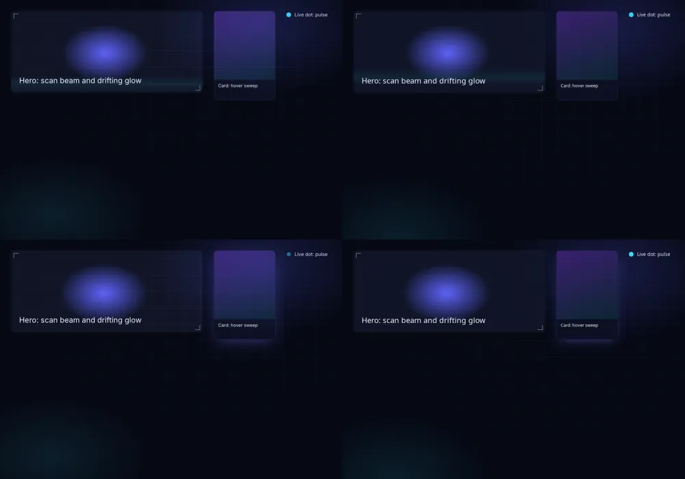

# BLITZ-3: what animations cost in Blitz, and making them cheap (2026-11-10)

Issue #82, condition 1 of the BLITZ-0 decision ([`blitz-0.md`](blitz-0.md),
#113): a running animation must cost only what it changes. Patches to Blitz,
anyrender and Stylo at the BLITZ-0 pins, measured with the prototype. Since
#121 they are carried in [`vendor/blitz/`](../../vendor/blitz/README.md), which
the prototype and `caskade-native` both build from.

**Result.** A frame caused only by an animation now repaints just what it
changed, frames that change nothing are skipped, and `steps()` animations
sleep until their next step. The status-bar spinner went from **46.9% to
8.2% of a core** at 60 frames a second. The budget is 2%, so a continuously
turning spinner still fails it: what's left (about 1.4 ms a frame) is
per-frame overhead: restyling, presenting, encoding GPU commands.
**A spinner that turns in 8 steps costs 1.85%** and passes, as does any
animation that changes a few times a second. All six animations in
`themes/` run as they do in WebKit, once two gradient bugs that hid the HUD
grid were fixed. Reduced motion and `data-paint="cpu"` pause the ambient
loops (0.3% and 0.06 CPU-s/min).

## What changes

Upstream-ready patches (descriptions [below](#upstream-pull-requests)):

| Repo | Patch | Effect |
| --- | --- | --- |
| Blitz | Centre angle linear gradients on the gradient box | `linear-gradient(90deg, …)` in a `background-size` tile was off-centre: the default theme's vertical grid lines vanished |
| Blitz | Fill edge-to-edge tiles of an axis-aligned linear gradient in one go | one repeating fill instead of one per tile; past 500 tiles nothing was drawn (the whole HUD grid, 570 tiles at 1440×900) |
| Blitz | Keep an inline `<svg>`'s snapshot when only its transform changed | a rotating icon no longer rebuilds and re-lays out every frame |
| Blitz | Repaint animation frames by what they change | damage tracking for animation-only frames, damage-limited painting, skipping unchanged frames, no restyle of paused animations, waking at the next `steps()` boundary |
| Blitz | Support `prefers-reduced-motion` | a viewport flag the embedder sets (`BLITZ_PREFERS_REDUCED_MOTION=1` forces it) |
| anyrender | Repaint only the damaged part of a frame (vello_hybrid) | `WindowRenderer::supports_damage`/`render_damage`; vello_hybrid keeps frames in its intermediate texture (now always used, except on Apple) and clears and draws only the damage |
| anyrender | In a damaged frame, fill only what lands in the damage | window-sized boxes are cut down to the damage before strip generation |
| Stylo | `Animation::next_change_after` | when a stepped animation next changes |
| Stylo | The `prefers-reduced-motion` media feature (Servo build) | `@media (prefers-reduced-motion: reduce)` evaluates |

Measurement-only (not for upstream): `ANYRENDER_PRESENT_MODE=immediate`
(unthrottled frames) and `ANYRENDER_FRAME_LIMIT_HZ=60` (paces presents like
vsync where nothing else does). `BLITZ_DAMAGE=0` turns damage-limited repaint
off for comparisons.

Both the prototype and `caskade-native` build against them from
`vendor/blitz/crates` (regenerated by `vendor/blitz/update.sh`, #121).

## Measurements

Linux X11, RTX 3090 (driver 610.43), Ryzen 9 5900X; the prototype on the real
library (1440×900 window), on the real GPU. The monitors were in DPMS off all
night, so no vsync paced the frames: presents were unthrottled and paced to
60 Hz by `ANYRENDER_FRAME_LIMIT_HZ=60` (a sleep after each present, as FIFO
blocks), so CPU per second is what a 60 Hz vsynced display would cost. CPU is
the whole process (all threads), over 20 s.

| Running | CPU, % of one core | Frames/s | CPU per frame |
| --- | ---: | ---: | ---: |
| Spinner, before (every frame repainted) | 46.9% | 60 | 7.8 ms |
| **Spinner, after** | **8.2%** | 60 | 1.37 ms |
| Spinner in 12 steps a turn (`steps(12)`) | 2.2% | 11.6 | 1.9 ms |
| **Spinner in 8 steps a turn (`steps(8)`)** | **1.85%** | 7.7 | 2.4 ms |
| Ambient background (steps; full-window repaints) | 7.65% | 8.9 | 8.6 ms |
| Ambient background, `prefers-reduced-motion` | 0.3% | 0 | — |
| Nothing animating | 0.3% | 0 | — |
| vello_cpu, ambient on, `data-paint="cpu"` (Xvfb) | 0.06 CPU-s/min | 0 | — |

Before, the ambient background repainted the whole window 60 times a second
(on Xvfb a full core). Now it repaints only when a step lands: about 9 times
a second.

Where a damaged spinner frame's ~1.4 ms goes (sampled with `pprof`, the
prototype's `profile` feature; perf is not available here): style
and layout for the restyled spinner 0.15–0.2 ms, scene building 0.3–0.4 ms
(mostly vello's strip generation for borders still crossing the damage),
GPU command encoding and submission 0.45 ms, presenting and the
intermediate-texture blit about 0.25 ms, the event loop the rest.

**Correctness.** With the spinner running, a damage-limited frame and a full
repaint differ only inside the spinner's own 24 px box (its angle at capture
time), on Xvfb at 1440×900.

## Theme animations against WebKit

`apps/native-proto/scripts/gallery.sh` renders
[`assets/gallery.html`](../../apps/native-proto/assets/gallery.html) (every
animation in `themes/` on the elements the theme styles) with the app's
compiled CSS in Blitz and in WebKitGTK 2.52 (MiniBrowser), each on a private
Xvfb, moves the pointer onto the card, and takes 24 screenshots 125 ms apart:

| Animation | Blitz: frames that changed | WebKit |
| --- | ---: | ---: |
| `cs-grid-pan`, `cs-nebula` (backdrop, `steps()`) | 23/23 | 13/23 |
| `cs-scan` (hero beam) | 23/23 | 23/23 |
| `cs-drift` (hero glow) | 23/23 | 23/23 |
| `cs-sweep` (card art, on hover) | 23/23 | 13/23 |
| `cs-pulse` (live dot) | 23/23 | 23/23 |



Everything runs and looks alike. Two differences remain:

- `cs-nebula` moves a quarter-pixel a step. Blitz draws sub-pixel positions,
  WebKit leaves some steps on the same pixels: both are correct.
- After the card's single sweep, Blitz keeps a faint change in the card art
  (at most 11 of 255 levels) for the rest of the capture; WebKit is still.
  Not yet explained; it doesn't affect cost (the card isn't in the spinner's
  damage).

The spike's open questions: `background-position` keyframes do run at this
revision, and vello_hybrid does animate on a real GPU.

## Acceptance criteria

| Criterion | Status |
| --- | --- |
| The status-bar spinner alone costs under 2% of one core on a vsynced display | **Not met for a continuous spinner** (8.2%); met by a spinner in 8 steps (1.85%), both measured with 60 Hz-paced presents on the real GPU. The vsynced-display run itself waits for a display that is on |
| All theme animations in `themes/` run as they do in WebKit | **Met**, with the two differences above |

To run on a vsynced display (monitors on; the window opens on top without
taking the focus; about a minute each):

```sh
cd apps/native-proto
CARGO_INCREMENTAL=0 flock /tmp/caskade-heavy.lock cargo build --profile proto --features log-frame-times,log-phase-times
CASKADE_PROTO_HOME=<library copy> CASKADE_PROTO_ON_TOP=1 CASKADE_PROTO_BENCH=spinner CASKADE_PROTO_BENCH_SECONDS=60 \
  python3 scripts/frames.py --out spinner-vsync -- <target dir>/proto/caskade-native-proto
# add CASKADE_PROTO_SPINNER_STEPS=8 for the stepped spinner
```

## Recommendation for condition 1 (#113)

The engine work removes the whole-window repaint, but a continuously animated
element still costs about 1.4 ms a frame, around 8% of a core at 60 Hz. Two
ways to close the gap:

1. **Design (recommended, no engine work):** the busy spinner turns in
   8 steps a turn (`steps(8)` on `cs-worker`, in both UIs: a common look for
   spinners). Measured at 1.85%. The other running animations in the app are
   brief (enter, sweep, shake) or ambient and stepped already.
2. **Engine (weeks, upstream):** animate `transform`/`opacity` on a
   compositor layer, without restyling or repainting, as browsers do. Smaller
   steps in the meantime: cull straight lines outside the clip in vello's
   strip generator (as it already does for curves), and damage support in
   vello_cpu, whose full repaints keep the no-GPU fallback at one core while
   anything animates.

## Other Blitz gaps found (for the upstream list)

From engineer 1's work on input and focus (#92), all at the BLITZ-0 pin:

- `:focus-visible` never matches (`NonTSPseudoClass::FocusVisible => false`).
- A click focuses only text inputs and clears focus otherwise, so buttons and
  `tabindex` elements can't be focused by clicking (`handle_click`).
- No public way to send a DOM event through `DioxusDocument`'s handler
  (`DioxusEventHandler`, `BlitzKeyboardData` are `pub(crate)`): no synthetic
  key presses.
- A programmatic scroll (`scroll_by`, `scroll_into_view`) sends no `scroll`
  event.
- `display: contents` on the focus target moves focus to an ancestor.
- `DioxusNativeApplication` downcasts the window's document to
  `DioxusDocument`, so a wrapping `Document` can't be used.

## Upstream pull requests

Not submitted: they go out under the user's name once approved. Each is one
patch file in `vendor/blitz/patches/`.

**DioxusLabs/blitz: "Centre angle linear gradients on the gradient box"**
(`blitz/0001`). A linear gradient given as an angle took its centre from the
element's border box; keyword directions used the gradient's own rectangle.
For a background sized with `background-size` the gradient box is the tile,
so tiled angle gradients drew only their start colour. Seen with
`linear-gradient(90deg, #0ff 1px, transparent 1px)` at
`background-size: 48px 48px`.

**DioxusLabs/blitz: "Fill edge-to-edge tiles of an axis-aligned linear
gradient in one go"** (`blitz/0002`). One repeating fill instead of a fill
per tile when the gradient's line spans its tile along one axis and the
tiles leave no gaps: the same pixels, one fill, and no 500-tile cutoff
(a 48 px grid over a 1440×900 window was not drawn).

**DioxusLabs/blitz: "Keep an inline `<svg>`'s snapshot when only its
transform changed"** (`blitz/0003`). A rotating inline SVG icon was rebuilt
from its source and re-laid out on every animation frame. The snapshot keeps
a hash of its source; damage to the `<svg>` alone no worse than a transform
keeps it when the source still serializes the same.

**DioxusLabs/blitz: "Repaint animation frames by what they change"**
(`blitz/0004`, needs the anyrender and Stylo PRs). A frame whose only cause
is an animation tick repaints only the union of where the animating
elements painted and where they paint now; frames with no visible change are
skipped; paused animations are no longer restyled; `steps()` animations
wake at their next step. New API: `BaseDocument::paint_damage`,
`next_animation_change`, `blitz_paint::paint_scene_damaged`. Any other cause
of a frame still repaints everything, so it fails safe. Numbers above.

**DioxusLabs/blitz: "Support prefers-reduced-motion"** (`blitz/0005`, needs
the Stylo PR). `Viewport::prefers_reduced_motion`, re-evaluated like the
colour scheme.

**DioxusLabs/anyrender: "Repaint only the damaged part of a frame
(vello_hybrid)"** and **"fill only what lands in the damage"**
(`anyrender/0001`, `0002`). `WindowRenderer::supports_damage` and
`render_damage` (defaults keep full frames); vello_hybrid renders through
its intermediate texture on every non-Apple surface so frames persist, then
clears (`ClearSettings::Rects`) and draws only the damage.

**servo/stylo: "Say when a stepped animation next changes"** (`stylo/0001`)
and **"Support the prefers-reduced-motion media feature"** (`stylo/0002`).
